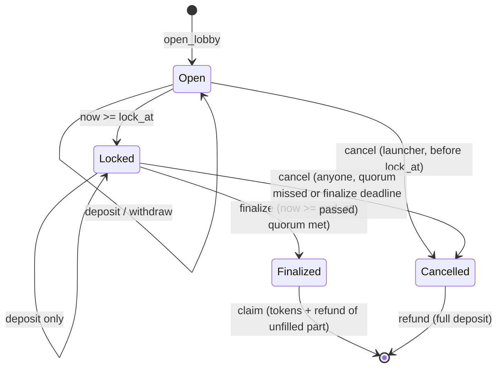

# Proposal: Fair Launch Lobby

> **Status:** draft proposal · **Not an official Float feature.**
> This document proposes a new launch mode for Float and specifies a reference
> implementation inside the community `float-router`. Anything that depends on
> how Float's own (closed) program behaves is marked **Assumption** and must be
> confirmed with the Float team before it is relied on.

## 1. Summary

Before a coin exists, its launcher opens a **lobby** for a few minutes. Anyone
can deposit the coin's paired token (SOL, USDC, NVDAx…). When the lobby closes,
one permissionless instruction **creates the coin on Raydium LaunchLab and
spends the deposits (up to the cap) in a single buy, in the same transaction**. Every
participant pays the **same average price**, oversubscription is filled
**pro rata** (no first-come race), and nobody (sniper, bundler or launcher)
can trade before the lobby, because the pool does not exist until the lobby
buys.

## 2. Motivation

- Today a launch is a race: the first blocks after `initialize` go to whoever
  has the fastest bundle. Float handles abuse **after the fact**: per the
  official docs, the 48 h ticker refund is withheld from launches that bought
  more than the first-buy cap and from wallets blocked for abuse (e.g. large
  bundled buys).
- Other launchpads fight snipers with decaying fees or size surcharges. Those
  still reward speed; they only make it more expensive.
- A lobby removes the race by construction and turns the launch into a shared,
  shareable moment ("lobby opens in 10 min, link here"), useful for
  communities, builders and the $FLOAT ecosystem.

## 3. Rule changes Float would need

| Current rule (official docs) | Proposed for lobby launches |
| --- | --- |
| Creator first buy capped at 2 % of supply, applied to the launch transaction | The lobby buy is a public batch, not a creator buy. Cap the **aggregate** lobby buy at `max_supply_bps` (default 15 %) and **each wallet** at `wallet_supply_bps` (default 1 %). The launcher's own deposit obeys the same per-wallet cap. |
| No refund if the launch bought more than the first-buy cap | Lobby launches that respect the caps above stay refund-eligible. |
| Ticker reuse fee by age of the existing ticker | The fee is quoted and paid when the lobby **opens**, and the ticker is **reserved** until the lobby finalizes or is cancelled. |

## 4. Lifecycle



| Phase | Window | Allowed |
| --- | --- | --- |
| Open | `open_at` → `lock_at` | deposit, withdraw, launcher cancel |
| Locked | `lock_at` → `end_at` | deposit only (no withdrawals: stops last-second quorum games) |
| Finalizable | `end_at` → `end_at + finalize_grace` | `finalize` by anyone if quorum met |
| Cancelled | quorum missed at `end_at`, or no finalize by the deadline, or launcher cancel | `refund` |
| Finalized | after `finalize` | `claim` |

## 5. Parameters

| Parameter | Default | Bounds (validated on chain) | Meaning |
| --- | --- | --- | --- |
| `duration_secs` | 600 | 120 – 3 600 | `end_at - open_at` |
| `lock_window_secs` | 60 | 0 – `duration_secs / 2` | withdrawals disabled during the last window |
| `finalize_grace_secs` | 600 | 60 – 3 600 | time after `end_at` to finalize before anyone can cancel |
| `min_raise` | launcher-set | > 0 | quorum in paired-token units |
| `min_wallets` | 10 | 1 – 1 000 | quorum in distinct depositors (sybil-able; a soft signal only) |
| `max_supply_bps` | 1 500 | 1 – `MAX_LOBBY_SUPPLY_BPS` (2 000) | aggregate buy may not receive more than this share of total supply |
| `wallet_supply_bps` | 100 | 1 – `max_supply_bps` | per-wallet allocation cap, expressed as share of supply |
| `unlock_secs` | 0 | 0 – 3 600 | optional linear unlock of claimed tokens after finalize |
| `reference_pool` | launcher-set | an existing LaunchLab pool on the same global config and Float's platform config | source of the genesis virtual reserves used to compute caps at open |
| `mint_params` | launcher-set | LaunchLab `MintParams` | name, symbol, URI, decimals; **frozen at open** so depositors know what they buy |

`max_raise` and `wallet_cap` are **derived**, never typed by the launcher.
They are the quote amounts that, at genesis reserves and with LaunchLab fees,
buy at most `max_supply_bps` / `wallet_supply_bps` of supply (see §6.1).

- At `open_lobby`, both are computed on chain from the virtual reserves of
  `reference_pool` (validated: owned by LaunchLab, same `global_config` and
  Float `platform_config`, same quote mint). `wallet_cap` is enforced on every
  deposit, so per-wallet totals never need to be recomputed.
- At `finalize`, the program reads the new pool's real genesis reserves right
  after the `initialize` CPI and recomputes `max_raise` from them. If they
  differ from the reference, the real value wins for the aggregate cap and an
  event records the difference.

The program cannot sum per-wallet values at finalize (there are unboundedly
many deposits), so every allocation input must be a running total kept at
deposit time.

## 6. Math

All arithmetic is integer, floor-rounded, overflow-checked (`u128`
intermediates). It lives in `float-core::lobby` and is mirrored by
`packages/sdk/src/float/lobby.ts` with shared vectors.

### 6.1 Caps from supply shares

LaunchLab's constant-product curve trades against reserves
`(vb, vq)` = virtual + real reserves (see `launchLab.quoteBuyExactIn` in the SDK).
At genesis `real_base = real_quote = 0`, so reserves are the pool's virtual
reserves, which depend only on the platform curve parameters: every Float
coin launched with the same curve shares them.

To receive `s` base tokens the net quote needed is
`net(s) = ceil(vq * s / (vb - s))`, and the gross deposit is
`gross(s) = preFeeAmount(net(s), total_fee_rate)` (same helper as the SDK).

- `max_raise  = gross(supply * max_supply_bps / 10_000)`
- `wallet_cap = gross(supply * wallet_supply_bps / 10_000)`

Binding rule: a cap is the **largest** gross amount `g` whose exact buy quote
(LaunchLab fee rounding included) returns **at most** the target share. Use the
closed form as the starting point and correct it by ±1 with the exact quote
function (or binary search), so rounding can never push `B` above the cap.
Test this edge directly.

**Assumption:** how LaunchLab derives `virtual_base` / `virtual_quote` from
`CurveParams` is not in the vendored IDL. Phase 1 reads them from an existing
Float pool with the same quote mint and curve (they are stored in `PoolState`);
if Raydium publishes the program source, vendor it verbatim (ground rule 4) and
port the formula.

### 6.2 Allocation

Let `d_i` be wallet *i*'s deposit (already ≤ `wallet_cap`, enforced at
deposit), `D = Σ d_i` (kept as a running total), and `R = min(D, max_raise)`.

On chain the lobby spends `R` in one `buy_exact_in` and receives `B` tokens.
Each wallet's figures are computed lazily at claim time from its own deposit
and the stored totals `D`, `R`, `B`:

```
refund_i   = floor(d_i * (D - R) / D)   // floor keeps the escrow solvent
spent_i    = d_i - refund_i
tokens_i   = floor(B * d_i / D)
price      = R / B                      // the same for everyone, fees included
```

Flooring guarantees `Σ refund_i ≤ D - R` (refunds never exceed what is left
in escrow) and `Σ tokens_i ≤ B`. The remainders are dust, settled at
`close_lobby`: quote dust goes to the treasury and token dust is burned. Each
participant's effective price `spent_i / tokens_i` equals `R / B` up to one raw
unit of rounding on each side.

**Shared test vector** (illustrative units, `wallet_cap` = 40):

| | A | B | C | Total |
| --- | --- | --- | --- | --- |
| deposit `d_i` | 40 | 30 | 20 | `D` = 90 |
| `max_raise` → spent by the lobby | | | | `R` = 60 |
| refund | 13 | 10 | 6 | 29 (quote dust 1) |
| spent | 27 | 20 | 14 | 61 |
| tokens (`B` = 5 901) | 2 622 | 1 967 | 1 311 | 5 900 (token dust 1) |

### 6.3 Unlock

With `unlock_secs = u > 0`, claimable at time `t` is
`floor(tokens_i * min(t - finalized_at, u) / u) - already_claimed_i`.

## 7. Accounts (reference implementation in `float-router`)

The lobby lives **inside `float-router`** (new file
`programs/float-router/src/instructions/lobby.rs`) because finalize must write
the `CoinRecord` and `TickerRecord` directly: `register_coin` requires the
launcher to sign, which a permissionless finalize cannot provide.

| Account | Seeds | Fields |
| --- | --- | --- |
| `Lobby` | `["lobby", launcher, nonce_le_u64]` | launcher, nonce, paired_mint, mint_params (bounded strings), ticker, timing (`open_at`, `lock_at`, `end_at`, `finalize_deadline`), `min_raise`, `min_wallets`, `max_supply_bps`, `wallet_supply_bps`, `unlock_secs`, reference reserves (`ref_vb`, `ref_vq`), `wallet_cap`, `max_raise` (set at open, aggregate recomputed at finalize), `total_deposits` (`D`), `depositors`, `raise_spent` (`R`), `tokens_bought` (`B`), `refunds_paid`, `tokens_claimed`, `finalized_at`, `state` (`Open/Finalized/Cancelled`), bumps, `_reserved` |
| `LobbyDeposit` | `["lobby_dep", lobby, wallet]` | wallet, `amount`, `claimed_tokens`, `refunded`, bump |
| quote escrow | `["lobby_quote", lobby]` (token account, authority = router authority PDA) | holds deposits |
| base vault | `["lobby_base", lobby]` (token account) | receives `B` |
| lobby SOL payer | `["lobby_sol", lobby]` (system-owned PDA, no data) | pre-funded by the launcher at open to pay LaunchLab rent (pool, vaults, mint, metadata); leftover returned at close |
| coin mint | `["lobby_mint", lobby]` (PDA) | becomes the LaunchLab `base_mint`; signs via `invoke_signed` |

`TickerRecord` gains a reservation (use its trailing space or a new
`TickerReservation` PDA `["ticker_res", ticker]` to avoid changing the existing
account layout).

## 8. Instructions

| Instruction | Signer | Effect and checks |
| --- | --- | --- |
| `open_lobby(params)` | launcher | Validate bounds (§5); validate `reference_pool` and read its virtual reserves; compute `wallet_cap` and `max_raise` (§6.1); quote the ticker fee by age (official tiers) and move it into the ticker escrow; reserve the ticker; store `mint_params`; create escrows; fund `lobby_sol`. |
| `deposit(amount)` | wallet | `Open` or `Locked`, `now < end_at`; cumulative deposit ≤ `wallet_cap`; transfer into escrow; update `D`; a deposit into an empty position increments `depositors`. |
| `withdraw(amount)` | wallet | `Open` only (`now < lock_at`); update `D`; a wallet whose deposit drops to 0 no longer counts in `depositors`, so depositing and withdrawing cannot inflate the `min_wallets` quorum. |
| `finalize()` | anyone | `now ≥ end_at`, `now ≤ finalize_deadline`, `D ≥ min_raise`, `depositors ≥ min_wallets`. **In one instruction:** CPI LaunchLab `initialize` (payer = `lobby_sol`, base_mint = mint PDA, creator = launcher, Float's platform config) → read real genesis reserves and recompute `max_raise` → `R = min(D, max_raise)` → assert `pool.real_base == 0` → CPI `buy_exact_in(R, min_out)` from escrow into the base vault → store `R`, `B` → write `CoinRecord` (launched_at = now) → emit `LobbyFinalized`. |
| `claim()` | wallet | `Finalized`; pay `refund_i` once and the unlocked part of `tokens_i` (§6.2, §6.3), computed from the wallet's deposit and the stored `D`, `R`, `B`; emit `LobbyClaimed { wallet, tokens, quote_spent, fee_share }`. |
| `cancel()` | launcher before `lock_at`; anyone if quorum missed after `end_at` or after `finalize_deadline` | state → `Cancelled`; release the ticker; ticker fee → launcher. |
| `refund()` | wallet | `Cancelled`; return the full deposit. |
| `close_lobby()` | anyone | after every deposit is settled: burn dust, return `lobby_sol` leftovers and rent to the launcher. |

If `initialize` plus `buy_exact_in` exceed the per-instruction account or
compute limits, split finalize into `finalize_create` and `finalize_buy` and
make `finalize_buy` check, through the Instructions sysvar, that
`finalize_create` for the same lobby ran earlier in the **same transaction**,
plus `pool.real_base == 0`. Never allow the two to land in different
transactions.

## 9. Invariants (must be tested)

1. Before finalize: `escrow.amount == Σ deposits` and `total_deposits == Σ deposit.amount`.
2. No trade can precede the lobby buy: the pool is created and bought in one
   transaction, and `real_base == 0` is asserted right before the buy.
3. Solvency: `Σ refund_i ≤ D - R` and `Σ tokens_i ≤ B` for any set of deposits, so the escrow and base vault can always pay every claim.
4. Every participant's effective price equals `R / B` up to one raw unit of rounding on each side.
5. Per-wallet cap and aggregate cap hold; `B ≤ supply * max_supply_bps / 10_000`.
6. Finalize is single-shot; claim and refund are single-shot per deposit.
7. Pre-funding the mint PDA (or any derived PDA) with lamports must **not**
   block finalize. Test this explicitly; if LaunchLab's `init` cannot handle a
   pre-funded mint, derive the mint from a seed that includes a value revealed
   only at finalize (e.g. a recent slot hash), and document it.
8. A coin can only be created from the lobby (the mint is a router PDA).

## 10. Interaction with Float mechanics

- **Fees:** the lobby buy pays normal LaunchLab fees, which are routed through
  the regular split. Each participant's share of those fees,
  `floor(fee · d_i / D)` (weighted by deposit, like `tokens_i`), is emitted
  in `LobbyClaimed.fee_share` so the airdrop scorer can count fees paid.
  **Assumption:** Float's trader score accepts this attribution. The
  launcher's own deposit does not count (a creator's trades on their own coin
  are excluded per the official docs).
- **Holder rewards:** lobby tokens sit in the lobby base vault until claimed.
  Exclude the vault owner from holder snapshots (add it to the payout bot's
  exclusion list) so rewards are not paid to unclaimed tokens.
- **Refund (48 h):** unchanged, measured from `finalized_at`.
- **Extension (v2): $FLOAT priority tier.** Wallets holding at least
  `X` $FLOAT through the lobby get their allocation filled before the pro-rata
  pass. Keep priority deposits as a separate running total, so the same
  claim-time formulas apply per tier. This gives $FLOAT a utility. Out of scope
  for v1.

## 11. Off-chain deliverables (Phase 1)

- `float-core::lobby`: parameter validation, phase from timestamps, caps from
  reserves, allocation, claimable with unlock. Unit tests and shared vectors.
- `packages/sdk/src/float/lobby.ts`: the same math, PDAs, account decoders
  (once the IDL exists), and `simulateLobby(deposits, params, reserves, rates)`.
- CLI: `float lobby simulate --deposits deposits.csv (--pool <launchlab_pool> | --virtual-base N --virtual-quote N) [--max-supply-bps 1500 --wallet-supply-bps 100]`,
  printing the allocation table, uniform price, refunds and the post-lobby
  curve price versus genesis.
- Fixtures: extend `scripts/dev/gen-fixtures.ts` with `lobby-allocation.json`.

## 12. Open questions for the Float team

1. Are lobby launches acceptable under the first-buy and refund rules (§3)?
2. Will lobby fee attribution count toward the trader airdrop score?
3. Is a router PDA acceptable as the LaunchLab `base_mint` authority path for
   Float coins (affects how Float's own program would port this)?
4. Should the $FLOAT priority tier ship in v1?
